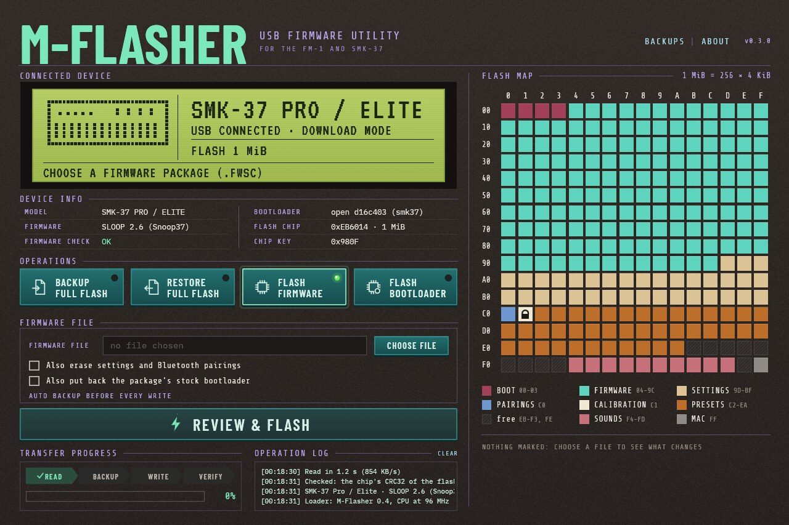

# M-Flasher

Back up, restore and reinstall the firmware of an **M-VAVE FM-1** or **SMK-37
Pro / Elite** over USB, and install
[m-bootloader](https://github.com/jvitkauskas/m-bootloader). It talks to
the chip's built-in USB download mode, so it also works when the firmware on
the unit is broken. For Windows, macOS and Linux.

> Unofficial: not affiliated with M-VAVE or JieLi. It saves a backup before it
> writes anything and checks every write, but use it at your own risk.

## Integration fork

This fork follows [jvitkauskas/m-flasher](https://github.com/jvitkauskas/m-flasher)
and adds the FM-1 read-only backup workflow, saved-file diagnostics, offline test
isolation. Felucca MIDI OTA uses its maintained
[Python updater](https://github.com/kmplngj/Felucca/blob/main/tools/fm1_install.py);
this fork retains upstream's MIDI download-mode soft key. The original issues,
PRs and exact historical sources remain in
[m-flasher-legacy](https://github.com/kmplngj/m-flasher-legacy).
See [repository migration](docs/repository-migration.md) for provenance and limits.

## What it does

- **Back up** the whole flash, and **restore** a backup.
- **Install firmware** from M-VAVE's `.fwsc` packages, as downloaded.
- **Install m-bootloader**, or put the stock one back.
- A **flash map** shows what each part of the flash holds and, before a
  write, exactly what will change.
- Checks the package is for this model, writes only what changes, and
  verifies everything written: see [Safety](docs/safety.md).
- **Inspect saved dumps**, compare files and export sanitized recovery diagnostics
  without discovering or connecting a device ([file-only commands](docs/saved-diagnostics.md)).
- A command line as well as the window.

## Getting started

1. Download the package for your system from the [releases](../../releases)
   and follow its short instructions. The apps are not signed, so the first
   start needs one extra confirmation.
2. Put the unit in **download mode** and connect it with a USB data cable:
   - with the unit running normally (M-VAVE's firmware or Felucca), just
     connect it: M-Flasher finds it on USB MIDI and its **DOWNLOAD MODE**
     button switches it over;
   - with m-bootloader: hold **REC** (SMK-37: **SEQ REC**) while
     switching it on;
   - with Felucca, SLOOP or Snoop37 running: hold **OCT-** and **OCT+** for 5 s.
3. M-Flasher finds the unit and shows what is on it. Start with a backup.

A unit with the stock bootloader and stock firmware cannot enter download mode
from its keys, but **DOWNLOAD MODE** works on it. Installing
[m-bootloader](https://github.com/jvitkauskas/m-bootloader) adds the keys and
a recovery menu for when the firmware does not start.

## More

- [Using M-Flasher](docs/usage.md): each system, download mode, the actions,
  the command line
- [Saved-file inspection and diagnostics](docs/saved-diagnostics.md): offline integrity,
  receipt checks, sanitized support output and advisory dry plans
- [Safety](docs/safety.md): what is checked before and after every write
- [How it works](docs/development.md): the protocol, the source, building
- [Experimental FMR1 reader check](docs/fm1-reader-check.md): selected Stock V15
  entry, two 256-byte reads and manual return; separate from the existing backup
- [Complete FMR1 raw backup](docs/fm1-raw-backup.md): two fresh passes, SHA-256
  comparison and two protected copies, with separate Stock-return evidence

## Credits and license

MIT ([LICENSE](LICENSE)); the optional [RAM reader](ram-reader/README.md) is
Apache-2.0 with its own notices. Bundled files and their licenses:
[data/NOTICE.md](data/NOTICE.md) and
[assets/README.md](assets/README.md). The protocol follows
[jl-uboot-tool](https://github.com/kagaimiq/jl-uboot-tool) by kagaimiq, and the
safety rules those of
[MvaveFM1Unbricker](https://github.com/Quixotic7/MvaveFM1Unbricker) and
[FM-1 Transporter](https://github.com/kurogedelic/FM-1-transporter).
